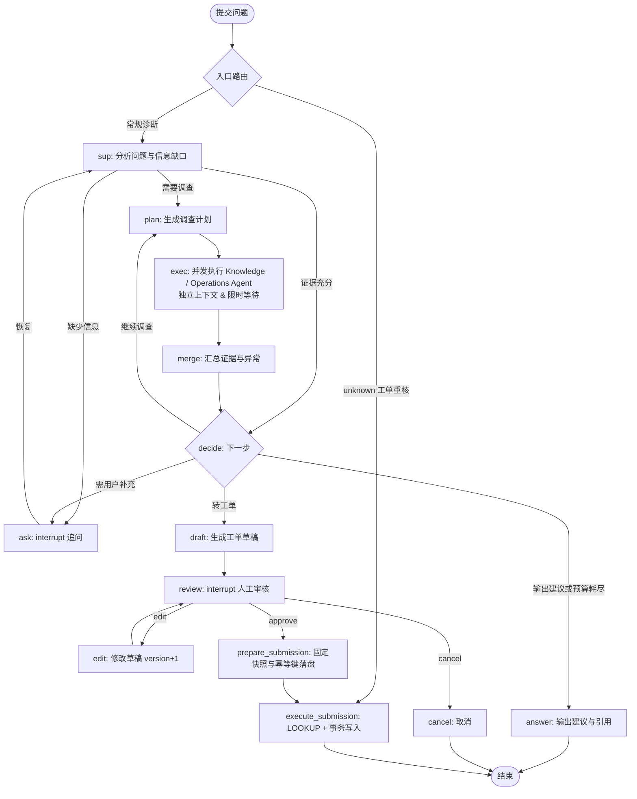

# SupportFlow

基于 LangGraph 的多 Agent 技术支持与工单工作台。面向模拟云存储 SaaS 排障场景，结合产品文档检索与只读业务工具（权限、配额、服务状态、请求日志）输出排查建议，并支持人工审核后创建幂等工单。

**技术栈：** `Python 3.11+` · `LangGraph` · `FastAPI` · `PostgreSQL / pgvector` · `BGE-M3` · `BM25` · `Streamlit`

---

## 流程架构



## 核心设计

- **主子状态隔离**：主图 `SupportState` 仅保存对话、轮次计划、证据字典与工单状态（由 PostgreSQL Checkpointer 持久化）；子 Agent 的消息流与工具调用记录隔离在局部 `AgentLocalState` 中，由 `exec` 节点统一限时等待并收敛为 `DiagnosisResult`。
- **混合检索与溯源**：知识诊断基于 `BGE-M3` (`pgvector`) + `BM25` 双路召回与 `RRF` 融合排序，定制分词保留错误码与配置项标识，按产品版本过滤并记录分块来源。
- **工具容错与限次重试**：使用 Pydantic 校验工具入参和出参。区分入参错误（回喂模型自纠）与出参契约损坏（当轮局部熔断）；运行诊断按 `task_id + tool_name + args` 生成逻辑调用 ID，对瞬时超时/连接异常最多原地重试 1 次，跨循环不重置计数。
- **工单审核与幂等提交**：利用 `interrupt` 实现草稿审核与带版本号修改。确认后先在 `prepare_submission` 节点固化提交快照与 `idempotency_key` 落盘，再进入 `execute_submission` 执行数据库唯一约束与事务写入；遇到提交结果未知（`unknown`）时保留原快照，支持从图入口直接路由重查恢复。

---

## 目录结构

```text
supportflow/
├── src/supportflow/
│   ├── state.py / schemas.py / config.py / deps.py
│   ├── context_policy.py        # 上下文投影与工具输出截断
│   ├── graph.py                 # 13 节点 LangGraph 主图编排
│   ├── agents/runner.py         # 通用子 Agent 循环执行器
│   ├── nodes/                   # investigation / supervisor / ticket 节点
│   ├── tools/                   # knowledge (混合检索) / operations (4类业务工具)
│   ├── persistence/             # PostgreSQL 连接池与幂等工单事务服务
│   └── api/                     # FastAPI 服务端 (server.py) 与 Streamlit 界面 (ui.py)
├── scripts/
│   ├── init_db.py               # 初始化数据库表与示例文档向量
│   └── run_eval.py              # 60 条任务基准评测脚本
└── tests/                       # 核心链路与工单并发幂等测试
```

---

## 快速开始

### 1. 安装依赖

```bash
python -m venv .venv
source .venv/bin/activate      # Windows: .venv\Scripts\Activate.ps1
pip install -e ".[dev]"
```

### 2. 启动服务

- **完整模式（PostgreSQL + LLM）**：复制 `.env.example` 为 `.env`，配置数据库连接串与 API Key，将 `SUPPORTFLOW_RUNTIME_MODE` 设为 `live`，初始化数据库后启动：
  ```bash
  python scripts/init_db.py
  uvicorn supportflow.api.server:app --reload --port 8000
  streamlit run src/supportflow/api/ui.py
  ```
- **本地免配置体验**：默认配置（`SUPPORTFLOW_RUNTIME_MODE=simulation`）下内置内存存储与仿真环境，直接运行上述 `uvicorn` 和 `streamlit` 命令即可本地体验追问、证据溯源、工单审核及故障注入。

### 3. 测试与评测

```bash
# 运行核心流程与工单 10 路并发幂等单测
pytest -v

# 运行 60 条任务基准评测（20 知识检索 + 20 运行诊断 + 20 跨领域）
python scripts/run_eval.py --out-md eval_report.md
```
